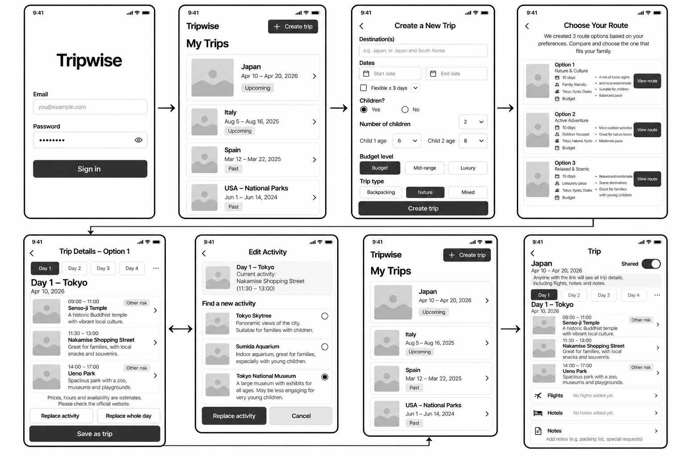
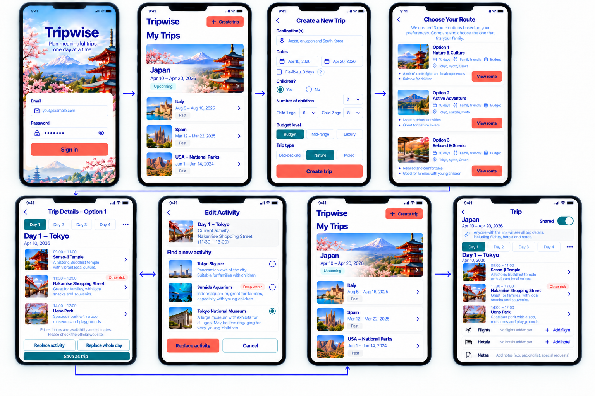
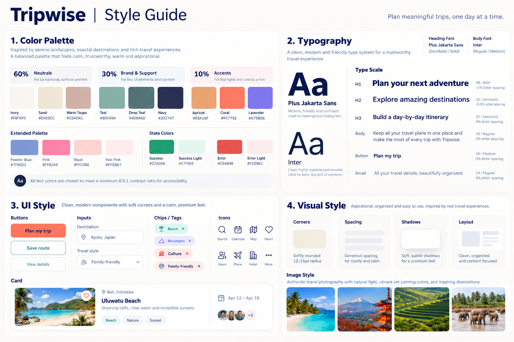

# DESIGN: TripWise

מבוסס על: `product-10-definitions.md`, `PRD.md`, ושלוש התמונות שלמטה.
עודכן: 20.10.2026. עודכן: 25.10.2026 (לפי פידבק המרצה וה-Wireframes וה-Mockups החדשים: 8 מסכים, כרטיס גדול לטיול הקרוב, מסך פירוט אחד, ומסך "Trip" אחד במקום מסך טיול ומסך סיכום). עודכן: 02.11.2026 (לפי קנבס העיצוב: כפתור החלפה בתוך כל כרטיס פעילות, פורמט תאריך יום-חודש-שנה, "Flexible ± N days", 8 מסכי מצבים חדשים לפי טקסטי ה-PRD, וצבעים וסולם טיפוגרפיה שנוספו לניגודיות ולמובייל). עודכן: 02.11.2026 (מסך כניסה עם מייל בלבד וקישור כניסה, בדיקת תקינות של המייל, מסכים 17 ו-18)

## קנבס העיצוב
העיצוב המדויק נמצא בקנבס "Tripwise — App Design". יש בו שלוש שורות:
1. **Foundations & Components:** לוח Style Guide (צבעים, טיפוגרפיה, ריווח, רדיוסים, צללים, אייקונים, תמונות) ולוח Components עם כל הרכיבים והמצבים שלהם. הלוחות האלה הם הבסיס לדיזיין סיסטם.
2. **Screens — core flow:** 8 המסכים מה-Mockups (מסכים 01–08), מחוברים כפרוטוטייפ לחיץ.
3. **States & edge cases:** מסכים 09–18, המצבים שלא צוירו ב-Mockups (ראו "מסכי מצבים").

כשיש סתירה בין ה-Mockups לבין הקנבס, הקנבס והמסמך הזה קובעים.

## תמונות הייחוס

ב-Mockups יש 8 מסכים, באותו סדר כמו ב-Wireframes. המסכים באנגלית ומשמאל לימין (LTR), לפי ה-PRD.
המסך My Trips מצויר פעמיים: בתחילת ה-Flow, ושוב אחרי השמירה.

| # בתמונה | הכותרת בתמונה | המסך ב-PRD |
|---|---|---|
| 1 | Sign in (מסך הכניסה, בלי כותרת) | טופס כניסה (F14). **עודכן:** מייל בלבד, בלי סיסמה |
| 2 | My Trips | המסך הראשי: רשימת טיולים (F1) |
| 3 | Create a New Trip | מסך יצירת טיול (F3) |
| 4 | Choose Your Route | מסך השוואת אפשרויות (F7) |
| 5 | Trip Details – Option 1 | מסך הצעה מפורטת (F8), כולל שמירה (F10) |
| 6 | Edit Activity | מסך הצעה מפורטת: עריכה ברמת יום (F9) |
| 7 | My Trips | המסך הראשי אחרי השמירה (F10) |
| 8 | Trip | מסך הטיול, שהוא גם מסך הסיכום (F2 ו-F20, עם F11 ו-F17 עד F19) |

## 1. Screens

### טופס כניסה (Sign in)
- המטרה: כניסה של הבעלים, שנוצרה ידנית ב-Supabase, **בלי סיסמה**: היא מקבלת קישור כניסה למייל (F14). אין הרשמה, אין סיסמאות ואין כניסה עם Google.
- מה יש במסך: תמונת רקע של יפן (הר פוג'י, פגודה ופריחת דובדבן) על כל המסך. שם המוצר "Tripwise" בגופן הכותרות, ומתחתיו השורה "Plan meaningful trips, one day at a time.". בתחתית כרטיס לבן (רדיוס 24) ובו: הכותרת "Sign in", השורה "Enter your email and we'll send you a sign-in link. No password needed.", שדה Email (אייקון מעטפה, placeholder: you@example.com, מקלדת מייל), וכפתור ראשי Coral "Send sign-in link" לכל הרוחב. אין שדה סיסמה.
- מה קורה במסך:
  - לחיצה על "Send sign-in link" בודקת קודם את המייל. שדה ריק: "Enter your email address.". מייל לא תקין: "Enter a valid email address, like you@example.com.". ההודעה מופיעה מתחת לשדה, עם אייקון התראה, בצבע Error Text, והשדה מקבל מסגרת Error (מסך 17). ההודעה נעלמת כשמתחילים להקליד.
  - מייל תקין: הכרטיס מתחלף ל-"Check your email" (מסך 18): אריח מעטפה, הכותרת, והשורה "If [email] has access to Tripwise, we sent a sign-in link to it. The link works for 1 hour.", וכפתור טקסט "Use a different email" שמחזיר לטופס. אותו נוסח מוצג לכל מייל תקין, כדי לא לחשוף איזה מייל רשום.
  - לחיצה על הקישור במייל פותחת את האפליקציה מחוברת, ב-My Trips.

### המסך הראשי: רשימת טיולים (My Trips)
- המטרה: לראות את כל הטיולים במקום אחד, עם הטיול הקרוב בראש, ולהתחיל טיול חדש.
- מה יש במסך: בכותרת העליונה "Tripwise", ומימין כפתור Coral קטן "+ Create trip". מתחתיה הכותרת "My Trips". תמיד רשימה, בפריסה אחת לטיול אחד או לכמה טיולים. הטיול הקרוב או הנוכחי מוצג **ככרטיס גדול ובולט בראש הרשימה**: תמונת יעד לכל רוחב הכרטיס, שם היעד (Japan), טווח תאריכים (10 Apr – 20 Apr 2026), תגית Upcoming וחץ ">". מתחתיו שאר הטיולים ברשימה קומפקטית: תמונה ממוזערת מצד שמאל, שם היעד, טווח תאריכים, תגית מצב (Upcoming בירקרק, Past באפור-חול), וחץ ">" מימין. הסדר בתמונה: Japan (כרטיס גדול), ואחריו Italy, Spain, USA – National Parks, כולם Past.
- מה קורה במסך: לחיצה על כרטיס פותחת את מסך הטיול (Trip). לחיצה על "Create trip" פותחת את מסך יצירת הטיול. כשאין טיולים מוצגת ההודעה "No trips yet." וכפתור "Create trip" (מסך 09 בקנבס).

### מסך יצירת טיול (Create a New Trip)
- המטרה: להזין את פרטי הטיול שה-AI צריך כדי ליצור 3 מסלולים. זה גם ה-Onboarding.
- מה יש במסך: חץ חזרה וכותרת. שדה Destination(s) עם אייקון מיקום (placeholder: Japan, or Japan and South Korea). שני שדות תאריך עם אייקון לוח שנה (התחלה וסיום), בפורמט יום-חודש-שנה (10 Apr 2026). שורת גמישות "Flexible ± N days": תיבת סימון, רשימה נפתחת של מספר הימים (1 עד 7, ברירת מחדל 3), המילה "days" ואייקון "?" להסבר. כשהתיבה לא מסומנת, הרשימה לא זמינה. שאלה "Children?" עם כפתורי רדיו Yes / No. כשנבחר Yes: "Number of children" כרשימה נפתחת, ושדה גיל לכל ילד (Child 1 age, Child 2 age) כרשימות נפתחות. "Budget level" כשלושה כפתורי בחירה: Budget / Mid-range / Luxury. "Trip type" כשלושה כפתורי בחירה: Backpacking / Nature / Mixed. הבחירה הפעילה ממולאת ב-Deep Teal עם טקסט לבן. בתחתית כפתור ראשי Coral "Create trip" לכל הרוחב.
- מה קורה במסך: בחירת Yes מציגה את שדות מספר הילדים והגילאים, ומספר שדות הגיל משתנה לפי מספר הילדים. "Create trip" שולח את הטופס ופותח את מסך ההשוואה. בדיקות הטופס לפי F3: תאריך סיום אחרי תאריך התחלה, גיל לכל ילד, ולפחות יעד אחד. בזמן היצירה הכפתור לא זמין ומוצג חיווי המתנה (הנחה 4 ב-PRD, מסך 10). בטיול של יותר מ-10 ימים מוצגת מתחת לתאריכים ההודעה "Long trip: generating routes will take longer, up to a few minutes." (מסך 12). בשגיאה מוצגת ההודעה "We couldn't create a route. Please try again." עם כפתור "Try again", והנתונים בטופס נשמרים (מסך 11).

### מסך השוואת אפשרויות (Choose Your Route)
- המטרה: להשוות בין 3 המסלולים שה-AI יצר ולבחור אחד.
- מה יש במסך: חץ חזרה, כותרת, ושורת הסבר "We created 3 route options based on your preferences. Compare and choose the one that fits your family.". שלושה כרטיסים **זה מתחת לזה**, וכולם נכנסים במסגרת הטלפון. בכל כרטיס: תמונה של היעד, "Option 1/2/3" ושם המסלול (Nature & Culture, Active Adventure, Relaxed & Scenic), שורת מאפיינים עם אייקונים (10 days, Family friendly, Budget), שורת ערים עם אייקון מיקום (למשל Tokyo, Kyoto, Osaka), שתי נקודות תקציר, וכפתור Coral "View route".
- מה קורה במסך: "View route" פותח את המסלול שנבחר במסך ההצעה המפורטת. משך הטיול, דרגת התקציב ותווית Family friendly זהים בשלושת הכרטיסים בכוונה, כי הם נגזרים מהנתונים שהמשתמשת הזינה בטופס (החלטה של Orly). מה שמבדיל בין הכרטיסים הוא השם, הערים והתקציר.

### מסך הצעה מפורטת (Trip Details – Option 1)
- המטרה: לראות את המסלול שנבחר לפי ימים, עם נימוק ותווית סיכון לכל פעילות, לערוך ברמת יום, ולשמור כ"תוכנית טיול". זה מסך אחד, לפני העריכה ואחריה.
- מה יש במסך: חץ חזרה וכותרת "Trip Details – Option 1". שורת לשוניות ימים (Day 1, Day 2, Day 3, Day 4, ותפריט "..." לשאר הימים), בגובה 40, והכפתור "..." בגודל 44×44. היום הפעיל ממולא ב-Deep Teal. כותרת היום (Day 1 – Tokyo) ותאריך (10 Apr 2026). רשימת פעילויות נגללת. כל פעילות היא כרטיס משני חלקים:
  - **החלק העליון:** תמונה ממוזערת, טווח שעות (09:00 – 11:00), שם הפעילות, נימוק קצר (למשל "Great for families, with local snacks and souvenirs.") וחץ ">". פעילות בסיכון מקבלת תגית עם אייקון ומילה, למשל "Other risk", ברקע Error Light עם טקסט Error Text.
  - **החלק התחתון:** כפתור "Replace activity" עם אייקון החלפה, לכל רוחב הכרטיס ובגובה 48 פיקסלים, בטקסט Deep Teal על רקע ירקרק בהיר מאוד (#F7FAF9), מופרד בקו דק. הגודל נבחר כדי שיהיה נוח ללחיצה באצבע גם לאנשים עם אצבעות גדולות (מעל המינימום של 44 פיקסלים).
  - מתחת לרשימה השורה הקבועה "Prices, hours and availability are estimates. Please check the official website.". בתחתית המסך, באזור קבוע: כפתור מתאר "Replace whole day" לכל הרוחב (גובה 52, עם אייקון לוח שנה), ומתחתיו כפתור ראשי Deep Teal "Save as trip" לכל הרוחב.
- מה קורה במסך: לחיצה על לשונית מחליפה את היום המוצג. לחיצה על "Replace activity" בתוך כרטיס פותחת את מסך עריכת הפעילות עבור הפעילות הזו בדיוק, בלי צורך לסמן אותה קודם. לחיצה על החלק העליון של הכרטיס מציגה את פרטי הפעילות. "Replace whole day" יוצר מחדש את כל היום המוצג (F9). "Save as trip" שומר את המסלול בשורה של הטיול בטבלת `trips` (F10), ומחזיר ל-My Trips, שם הטיול מופיע ככרטיס הגדול בראש הרשימה.

### מסך הצעה מפורטת: עריכה ברמת יום (Edit Activity)
- המטרה: להחליף פעילות אחת ביום, בלי לשנות את שאר היום.
- מה יש במסך: חץ חזרה וכותרת "Edit Activity". כרטיס של הפעילות הנוכחית, ברקע חול בהיר (#F1EBDF): תמונה, "Day 1 – Tokyo", התווית "CURRENT ACTIVITY", שם ושעות (Nakamise Shopping Street, 11:30 – 13:00). זו הפעילות שבכרטיס שלה נלחץ "Replace activity" במסך הקודם. תחת "Find a new activity" שלוש חלופות עם כפתורי רדיו: תמונה, שם, נימוק, ותגית סיכון כשיש (Deep water על Sumida Aquarium). בתחתית כפתור ראשי Coral "Replace activity" וכפתור מתאר "Cancel".
- כל חלופה היא כרטיס לחיץ כולו (תווית עם כפתור רדיו). החלופה שנבחרה מקבלת מסגרת Deep Teal בעובי 2 פיקסלים. שני כפתורי התחתית יושבים זה לצד זה, בגובה 52.
- מה קורה במסך: המשתמשת בוחרת חלופה אחת ולוחצת "Replace activity". הפעילות מוחלפת ביום, וחוזרים ל-Trip Details, שבו הפעילות החדשה מופיעה במקומה. "Cancel" חוזר בלי שינוי. החלופות נוצרות לפי F9, עם היום שלפני והיום שאחרי כהקשר נעול.

### מסך הטיול (Trip)
- המטרה: המקום הקבוע של טיול שמור. מסך אחד שמרכז את המסלול לפי ימים, את השיתוף, ואת הטיסות, המלונות וההערות. הוא גם מסך הסיכום (F2 ו-F20).
- מה יש במסך: חץ חזרה וכותרת "Trip". שם הטיול (Japan) ותאריכים. מתג "Shared" ב-Deep Teal. מתחתיו תיבת אזהרה עם אייקון קישור: "Anyone with the link will see all trip details, including flights, hotels and notes.". לשוניות ימים, כותרת יום ותאריך, ורשימת הפעילויות עם שעות, נימוק ותגיות סיכון. מתחת למסלול שלוש שורות מתקפלות, כל אחת עם אייקון: "Flights" (מטוס, "No flights added yet." וקישור "+ Add flight"), "Hotels" (מיטה, "No hotels added yet." וקישור "+ Add hotel"), ו-"Notes" (מסמך, placeholder: Add notes (e.g. packing list, special requests)). כרטיסי הפעילויות במסך הזה הם לקריאה בלבד: בלי כפתור "Replace activity".
- מה קורה במסך: הפעלת "Shared" מסמנת את הטיול כמשותף, וכתובת המסך הזה היא קישור הצפייה (הנחה 5 ב-PRD). "Add flight" ו-"Add hotel" פותחים חלון שעולה מתחתית המסך (bottom sheet, מסכים 14 ו-15), והפרטים מוצגים אחר כך כתצוגה סטטית בלבד (F17, F18, מסך 16). ההערות נשמרות בשורת הטיול (F19). צופה בלי כניסה רואה את אותו מסך בלי מתג ובלי פעולות הוספה או עריכה. טיול שלא סומן משותף מציג לצופה "This trip is not available." (F11). ב-MVP בלי ה-Should, המסך מציג רק את המסלול ואת השיתוף.

### ניווט בין המסכים
- ה-Flow המרכזי, לפי סדר התמונות: Sign in ← My Trips ← Create a New Trip ← Choose Your Route ← Trip Details ⇄ Edit Activity ← (Save as trip) ← My Trips ← Trip.
- My Trips הוא הבית. לחיצה על כרטיס טיול פותחת את מסך Trip של אותו טיול. הכפתור "Create trip" פותח את מסך היצירה.
- בכל מסך חוץ מ-Sign in ו-My Trips יש חץ חזרה בפינה השמאלית העליונה.
- עריכה ברמת יום: מ-Trip Details, הכפתור "Replace activity" שבתוך כרטיס פעילות פותח את Edit Activity עבור הפעילות הזו, ו-"Replace whole day" נשאר באותו מסך ומחליף את היום. "Replace activity" ו-"Cancel" ב-Edit Activity חוזרים ל-Trip Details.
- אחרי "Save as trip" הטיול נשמר, וחוזרים ל-My Trips, שם הוא מופיע ככרטיס הגדול בראש הרשימה.
- הזנת טיסות ומלונות אין לה נקודת כניסה קבועה אחת (PRD). בתמונות היא נמצאת במסך Trip.

### מסכי מצבים (שורה 3 בקנבס)
כל הטקסטים לקוחים מטבלת "טקסטים קבועים בממשק" ב-PRD.

| # | מסך | מה יש בו |
|---|---|---|
| 09 | My Trips: ריק | איור קטן (מיקום ומטוס על עיגול חול), "No trips yet." וכפתור ראשי "+ Create trip". בלי הכפתור הקטן בכותרת, כדי שלא יהיו שני כפתורים זהים. |
| 10 | Create trip: חיווי המתנה | הטופס מעומעם ולא זמין. כרטיס סטטוס עם ספינר, "Creating 3 route options…", "Please keep this screen open." ופס התקדמות. הכפתור "Creating trip…" לא זמין, עם ספינר. |
| 11 | Create trip: שגיאה | הטופס עם הנתונים שהוזנו. תיבת שגיאה "We couldn't create a route. Please try again." וכפתור ראשי "Try again". |
| 12 | Create trip: טיול ארוך | מעל 10 ימים. תאריך הסיום מודגש במסגרת כתומה, ומתחת לתאריכים הודעה "Long trip: generating routes will take longer, up to a few minutes." בצבעי Warning. |
| 13 | קישור משותף: לא זמין | לצופה בלי כניסה. שם המוצר, איור קישור, "This trip is not available.". בלי חץ חזרה ובלי פעולות. |
| 14 | Add flights | חלון מתחתית המסך. שני חלקים, OUTBOUND ו-RETURN (הלוך ושוב, F17). בכל חלק: From, To, Date & time (התאריך מבורר תאריכים), Flight no. כפתור "Save". |
| 15 | Add hotel | חלון מתחתית המסך. Hotel name, Check-in, Check-out (F18). כפתור "Save". |
| 16 | Trip: אחרי הזנה | התצוגה הסטטית: כרטיס טיסה לכל כיוון (קוד שדה, שעה ומספר טיסה), כרטיס לכל מלון (שם, תאריכים ומספר לילות), והערות. |
| 17 | Sign in: מייל לא תקין | שדה המייל עם מסגרת Error והודעה "Enter a valid email address, like you@example.com." מתחתיו. |
| 18 | Sign in: הקישור נשלח | הכרטיס "Check your email" עם המייל שהוזן ו-"Use a different email". |

הערה: השדות בתוך כל כיוון של הטיסה (From, To, Date & time, Flight no.) הם הנחה של העיצוב. ה-PRD קובע רק "הלוך ושוב".

## 2. Style Guide

### צבעים
חלוקה של 60-30-10, לפי `style-guide.png`.

| קבוצה | שם | HEX | שימוש במסכים |
|---|---|---|---|
| 60% Neutrals | Ivory | #F8F6F0 | רקע המסכים |
| | Sand | #EAE0CC | תגית Past, רקעים משניים |
| | Warm Taupe | #C9ADA1 | גבולות ופרטים עדינים |
| 30% Brand & Support | Teal | #80A99A | אייקונים ופרטים משניים |
| | Deep Teal | #4D6A6D | לשונית יום פעילה, בחירה פעילה בטופס, "Save as trip", מתג Shared, כפתורי מתאר |
| | Navy | #252747 | כותרות וטקסט ראשי, טקסט על כפתורי Coral |
| 10% Accents | Apricot | #E5A16F | הדגשה משנית |
| | Coral | #FF775E | כפתורי פעולה ראשיים: Sign in, Create trip, View route, Replace activity |
| | Lavender | #6758D6 | הדגשה, שימוש מועט |
| Extended | Powder Blue | #7F95D1 | |
| | Pink | #FF82A9 | |
| | Blush | #FFC0BE | |
| | Pale Pink | #FFEBE7 | |
| State | Success | #22A06B | |
| | Success Light | #E7F6EE | תגית Upcoming |
| | Success Text | #17774F | טקסט תגית Upcoming (נוסף לניגודיות) |
| | Error | #E54848 | מסגרת שדה בשגיאה |
| | Error Light | #FDEBEC | רקע של תוויות סיכון ותיבת שגיאה |
| | Error Text | #B83232 | טקסט של תוויות סיכון ושגיאות (נוסף לניגודיות) |
| | Warning Light | #FCEFE3 | רקע הודעת טיול ארוך (נגזר מ-Apricot) |
| | Warning Text | #7A4115 | טקסט הודעת טיול ארוך |
| Text & lines | Text | #252747 | טקסט ראשי (Navy) |
| | Text 2 | #545771 | טקסט משני: תאריכים, נימוקים |
| | Text 3 | #6B6D85 | טקסט שלישוני: placeholder, הערות קטנות |
| | Border | #E3DDD1 | מסגרות שדות וכפתורים |
| | Divider | #EFEBE3 | קווי הפרדה ומסגרות כרטיסים |

- כלל ניגודיות: כל טקסט עומד ביחס 4.5:1 לפחות מול הרקע שלו. לכן הטקסט על כפתורי Coral הוא Navy כהה, ולא לבן (תוקן בשלב ה-Mockups).
- הטקסט האדום #E54848 על #FDEBEC מגיע רק ליחס של כ-3.8:1, ולכן טקסט על רקע בהיר משתמש ב-Error Text וב-Success Text הכהים.
- מצב לא מועבר בצבע בלבד: תוויות הסיכון ותגיות המצב תמיד כוללות מילה, ותוויות הסיכון גם אייקון משולש.
- תוויות הסיכון (לפי ה-PRD): Extreme sport / Deep water / Rough terrain / Other risk.

### גופנים
- כותרות: Plus Jakarta Sans, במשקל Semibold או Bold.
- טקסט ורכיבי ממשק: Inter, במשקל Regular או Medium.

| רמה | גודל ומשקל | ריווח אותיות |
|---|---|---|
| H1 | 48, Bold | ‎-1%‎ |
| H2 | 32, Semibold | ‎-0.5%‎ |
| H3 | 24, Semibold | 0% |
| Body | 16, Regular | 0% |
| Button | 16, Medium | 0% |
| Small | 14, Regular | 0% |

הסולם שלמעלה גדול מדי למסך טלפון, ולכן המסכים משתמשים בסולם מובייל שנגזר מה-Mockups:

| רמה | גופן | גודל/גובה שורה ומשקל | דוגמה |
|---|---|---|---|
| Display | Plus Jakarta Sans | 40/48, ExtraBold | Tripwise במסך הכניסה |
| Title L | Plus Jakarta Sans | 30/36, Bold | My Trips |
| Title M | Plus Jakarta Sans | 22/28, Bold | Day 1 – Tokyo |
| Nav title | Plus Jakarta Sans | 19/24, Bold | כותרת מסך עם חץ חזרה |
| Item title | Inter | 16/22, Semibold | שם פעילות |
| Body | Inter | 16/24, Regular | |
| Small | Inter | 14/20, Regular | תאריכים, תוויות שדות |
| Caption | Inter | 12/16, Semibold | שעות, תגיות. 12 הוא הגודל המינימלי |

### פורמט תאריך
יום-חודש-שנה, עם שם חודש מקוצר באנגלית: "10 Apr 2026". טווח: "10 Apr – 20 Apr 2026". בלי שנה כשהיא ברורה מההקשר: "10 Apr – 14 Apr". בנתונים התאריך נשמר כ-`YYYY-MM-DD`.

### כפתורים ורכיבים
- **כפתור ראשי:** מילוי Coral, טקסט Navy, פינות מעוגלות. לכל הרוחב בתחתית מסך (Sign in, Create trip), או קטן בתוך כרטיס (View route).
- **כפתור ראשי משני:** מילוי Deep Teal, טקסט לבן ("Save as trip").
- **כפתור מתאר:** רקע לבן, מסגרת וטקסט Deep Teal ("Replace whole day", "Cancel").
- **שדות קלט:** רקע לבן, מסגרת דקה בהירה, פינות מעוגלות, אייקון מימין לתווית בצד שמאל (מיקום, לוח שנה, מעטפה, מנעול), ותווית מעל כל שדה.
- **בורר אפשרויות:** שורה של שלושה כפתורים שווים. הבחירה הפעילה ממולאת ב-Deep Teal עם טקסט לבן, והשאר לבנים עם מסגרת.
- **לשוניות ימים:** הלשונית הפעילה ממולאת ב-Deep Teal, והשאר בהירות. בסוף השורה "..." לימים נוספים.
- **כרטיס טיול גדול (Hero):** לטיול הקרוב בראש My Trips. תמונה לכל רוחב הכרטיס, ומתחתיה שם היעד בגופן הכותרות, תאריכים, תגית מצב וחץ ">".
- **כרטיס טיול / פעילות:** רקע לבן, פינות מעוגלות, צל עדין, תמונה ממוזערת משמאל, טקסט באמצע וחץ ">" מימין.
- **כרטיס פעילות לעריכה (Trip Details):** כמו כרטיס פעילות, ובתחתיתו כפתור "Replace activity" לכל רוחב הכרטיס, בגובה 48. במסך Trip הכרטיס בלי הכפתור.
- **גודל מטרת לחיצה:** כל כפתור, קישור או אזור לחיץ הוא לפחות 44×44 פיקסלים. כפתורי פעולה ראשיים בגובה 52, ופעולות בתוך כרטיס בגובה 48.
- **Toast:** רקע Navy, טקסט לבן, אייקון וי בעיגול Success, וקישור פעולה (למשל "Trip saved to My Trips · Open" במסך 07).
- **חלון מתחתית המסך (Bottom sheet):** רקע לבן, פינות עליונות ברדיוס 24, ידית קטנה למעלה, כותרת עם אייקון, כפתור סגירה עגול, ומסך מעומעם מאחור (Navy ב-45%).
- **כרטיס סטטוס בהמתנה:** אייקון ספינר, כותרת, שורת הסבר ופס התקדמות ב-Teal.
- **תגיות (Chips):** צורת גלולה. Upcoming בירקרק בהיר, Past בחול, תוויות סיכון (Other risk, Deep water) בוורוד בהיר עם טקסט אדום.
- **מתג:** "Shared" ב-Deep Teal כשהוא פעיל.
- **תיבת הודעה:** רקע בהיר עם אייקון, לאזהרת השיתוף.
- **שורה מתקפלת:** במסך Trip, לטיסות, מלונות והערות. אייקון, כותרת, טקסט מצב ריק באפור ("No flights added yet.") וקישור הוספה.
- **אייקונים:** קו דק, סגנון אחיד: Calendar, Location, Mail, Link, Plane, Hotel, Notes, More. Lock ו-Eye כבר לא בשימוש, כי אין סיסמה. האייקונים Map, Heart ו-Users שב-Style Guide לא בשימוש, כי אין במוצר מפה, מועדפים או כמה משתמשים.

### פינות, צורות ומרווחים
- רדיוסים: 12 לשדות ולתמונות ממוזערות, 14 לכפתורים, 16 לכרטיסים, 24 לחלון מתחתית המסך. תגיות בצורת גלולה.
- ריווח ברשת של 4: ‏4, 8, 12, 16, 20, 24, 32, 40, 48. שוליים צדדיים של המסך 20 (16 במסכי רשימה), ריווח פנימי בכרטיס 10 עד 16, ריווח בין אזורים 14 עד 24.
- צללים רכים בגוון Navy: sm לשורות ושדות, md לכרטיסים, lg לחלונות ול-Toast.
- פריסה נקייה ומסודרת, שהתוכן במרכזה. מסך טלפון ברוחב 375 פיקסל קודם, לפי ה-PRD.

### אווירה כללית
רגועה, אמינה, חמה ושואפת. השראה מנופים שלווים, יעדי חוף וחוויות טיול. תמונות טיול אמיתיות באור טבעי, בצבעים חיים אבל רגועים. בתמונות התוכן יפן (פוג'י, פגודות, פריחת דובדבן), כי זה טיול הדוגמה.

## פערים שאושרו
פערים קטנים בין התמונות לבין ה-PRD, שהוחלט להשאיר כמו שהם:
1. ב-Edit Activity, לכרטיס Tokyo Skytree חסרה התווית "Other risk" שמופיעה ב-Wireframes.
2. במסך הכניסה מופיעה שורת התגית מה-Style Guide, "Plan meaningful trips, one day at a time.", שלא מופיעה ב-Wireframes.
3. מצבים שה-PRD מגדיר ולא מצוירים ב-Mockups: רשימת טיולים ריקה, חיווי המתנה, הודעת השגיאה, הודעת הטיול הארוך, וההודעה "This trip is not available.". **עודכן:** הם מצוירים עכשיו בקנבס, במסכים 09–13 (ראו "מסכי מצבים").
4. טופס הזנת טיסה ומלון לא מצויר ב-Mockups. **עודכן:** הוא מצויר בקנבס, במסכים 14–16.
5. במסך Trip לא רואים את השורה "Prices, hours and availability are estimates..." בגבולות התמונה. היא מופיעה מתחת לרשימת הפעילויות, כמו ב-Trip Details.

## שינויים מה-Mockups שהוחלטו (02.11.2026)
1. **בחירת פעילות להחלפה:** ב-Mockups לא היה ברור איזו פעילות "Replace activity" מחליף. הוחלט שכל כרטיס פעילות ב-Trip Details מקבל כפתור "Replace activity" משלו, גדול ונוח ללחיצה (48 פיקסלים), ולחיצה על שאר הכרטיס פותחת את הפרטים. הכפתור הוסר מתחתית המסך.
2. **פורמט תאריך:** יום-חודש-שנה ("10 Apr 2026"), במקום "Apr 10, 2026" שב-Mockups. תואם להנחה 8 ב-PRD.
3. **גמישות בתאריכים:** "Flexible ± N days", כש-N נבחר מרשימה, במקום "± 3 days" הקבוע שב-Mockups. תואם ל-PRD.
4. **כפתור השמירה:** נשאר "Save as trip" כמו ב-Mockups, למרות שבטבלת הטקסטים ב-PRD כתוב "Save". בטפסי הטיסה והמלון הכפתור הוא "Save".
5. **טקסט על כפתורי Coral:** Navy, ולא לבן כמו ב-Mockups (כבר הוחלט בשלב ה-Mockups).
6. **מסך 07:** נוסף Toast "Trip saved to My Trips", כדי שיהיה משוב על השמירה.
7. **שורת סטטוס:** לא מציירים שורת סטטוס מזויפת (9:41) בעיצוב.
8. **כניסה בלי סיסמה:** במסך הכניסה נשאר רק שדה מייל, והכניסה נעשית בקישור שנשלח למייל, במקום שדה Password ואייקון העין שב-Mockups. כך אין סיסמה שאפשר לשכוח. נוספה בדיקת תקינות של המייל עם הודעות שגיאה (מסכים 17 ו-18).

## הנחות
1. **הנחה:** Edit Activity הוא מצב של מסך ההצעה המפורטת, ולא מסך חדש ב-PRD.
2. **הנחה:** צופה בקישור השיתוף רואה את מסך Trip בלי מתג Shared ובלי פעולות הוספה או עריכה.
3. **הנחה:** הצבעים Apricot, Lavender והצבעים המורחבים לא מופיעים במסכים שבתמונה. הם שמורים להדגשות עתידיות, ולא מוסיפים אותם בלי צורך.
